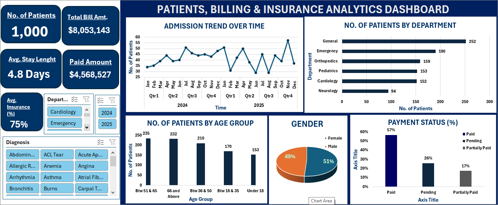

# Secure Life General Hospital: Patient, Billing & Insurance Analytics Dashboard

> **An interactive Excel dashboard that turns 1,000 patient visits (2024 — 2025) into clear answers on admissions, revenue, insurance coverage and unpaid bills.**

---

## Results at a Glance

| Metric | Value |
|---|---|
| Patient visits recorded | **1,000** (Jan 2024 — Dec 2025) |
| Total billed | **$8,053,143** |
| Collected (fully paid bills) | **$4,568,527** (56.7%) |
| Outstanding | **$3,484,616** (43.3% of billing) |
| Average length of stay | **4.8 days** |
| Average insurance coverage | **75%** |

**The three findings management should act on first**

1. **Two departments drive the money.** Orthopedics and Cardiology are 31% of patients but **58% of total billing** and **57% of unpaid bills**.
2. **43 cents of every billed dollar is still uncollected.** Pending bills alone account for **$2.08M**, and General has the lowest collection rate (50.4%).
3. **Demand swings sharply month to month.** Admissions ranged from **29 to 57 patients a month**, which makes staffing and bed planning difficult.

---

## Table of Contents
- [Business Problem](#-business-problem)
- [Dataset](#-dataset)
- [Tools & Skills](#-tools--skills)
- [Data Preparation](#-data-preparation)
- [Dashboard Features](#-dashboard-features)
- [Answers to the 10 Business Questions](#-answers-to-the-10-business-questions)
- [Additional Insights](#-additional-insights-beyond-the-brief)
- [Recommendations](#-recommendations)
- [Data Limitations](#-data-limitations--assumptions)
- [About the Author](#-about-the-author)

---

## Business Problem

The management of **Secure Life General Hospital** noticed changes in patient admissions, rising outstanding medical bills and uneven insurance coverage across departments. The hospital had patient, billing and insurance data but **no consolidated view** of its operational and financial performance.

**My role:** Data Analyst. The task was to transform the raw data into insights and build an **interactive dashboard** that management can use to monitor performance and make decisions, going beyond the ten required objectives with extra insights of my own.

---

## Dataset

The dataset holds **1,000 patient visits** across **6 departments** and **39 diagnoses**. Each row is **one visit, not one unique patient**.

| Column | Description |
|---|---|
| Patient ID | Unique ID for each visit/record |
| Patient Name | Name of the patient |
| Age | Age at time of visit |
| Gender | Patient gender |
| Admission Date / Discharge Date | Dates the patient was admitted and discharged |
| Department | Cardiology, Emergency, General, Neurology, Orthopedics, Pediatrics |
| Diagnosis | Medical condition recorded for the visit |
| Total Bill Amount | Total amount charged |
| Insurance Coverage (%) | Share of the bill covered by insurance |
| Payment Status | Paid, Pending or Partially Paid |

**Columns I engineered** (shown in the *Hospital Patients* sheet):

| New column | Logic |
|---|---|
| Length of stay | Discharge Date — Admission Date (days) |
| Age Category | Age Group Accounting for Patients' Visits e.g., Under 18, 66 and Above etc |
| Insurance Amount Coverage | Total Bill / Insurance Coverage % |
| Patients' Coverage | Total Bill — Insurance Amount (the patient's share) |
| Paid Amount | Amount actually received (see [limitations](#-data-limitations--assumptions)) |

---

## Tools & Skills

- **Microsoft Excel**: PivotTables, PivotCharts, Slicers, calculated columns, conditional logic
- **Dashboard design**: KPI cards, interactive filters, consistent colour theme
- **Data validation**: duplicate checks, date/stay-length reconciliation, null checks
- **Business storytelling**: turning numbers into recommendations

---

## Data Preparation

- Confirmed **1,000 rows with 1,000 unique Patient IDs** and no missing values
- Verified that *Length of stay* equals discharge minus admission date for **every record**
- Created the age bands, insurance amount, patient share and paid amount columns
- Built PivotTables on a dedicated sheet that feed every dashboard visual
- Added slicers for **Department, Year and Diagnosis** so every KPI and chart updates together

---

## Dashboard Features

| Section | What it shows |
|---|---|
| **KPI cards** | No. of patients, total bill, average stay, paid amount, average insurance % |
| **Admission trend** | Monthly admissions across 2024 — 2025, grouped by quarter |
| **Patients by department** | Which departments carry the patient load |
| **Patients by age group** | Where demand sits across age bands |
| **Gender split** | 51% female, 49% male |
| **Payment status** | Paid vs pending vs partially paid |
| **Slicers** | Department, Year and Diagnosis filters for self-service exploration |

---

## Answers to the 10 Business Questions

### 1. How many patient visits has the hospital recorded?
**1,000 visits** between 1 Jan 2024 and 28 Dec 2025: 508 in 2024 and 492 in 2025.

### 2. Which departments receive the highest number of patients?
| Rank | Department | Visits | Share |
|---|---|---|---|
| 1 | General | 252 | 25.2% |
| 2 | Emergency | 190 | 19.0% |
| 3 | Orthopedics | 159 | 15.9% |
| 4 | Pediatrics | 153 | 15.3% |
| 5 | Cardiology | 152 | 15.2% |
| 6 | Neurology | 94 | 9.4% |

### 3. Which departments generate the highest total bills?
| Department | Total Billed | Share of Revenue | Avg Bill per Visit |
|---|---|---|---|
| **Orthopedics** | $2,553,862 | 31.7% | $16,062 |
| **Cardiology** | $2,095,438 | 26.0% | $13,786 |
| Neurology | $1,215,303 | 15.1% | $12,929 |
| General | $993,027 | 12.3% | $3,941 |
| Emergency | $622,525 | 7.7% | $3,276 |
| Pediatrics | $572,988 | 7.1% | $3,745 |

**General has the most patients but only 12% of revenue.** Orthopedics has 16% of patients and 32% of revenue. Volume and value are very different things.

### 4. What is the average length of stay across departments?
| Department | Avg Stay (days) |
|---|---|
| Orthopedics | 8.4 |
| Neurology | 6.9 |
| Cardiology | 6.5 |
| General | 3.9 |
| Pediatrics | 3.0 |
| Emergency | 2.0 |
| **Hospital average** | **4.8** |

Longest-stay diagnoses: **Knee Replacement (9.7 days)**, **Carpal Tunnel (8.6)** and **Hip Fracture (8.5)**.

### 5. What proportion of patient bills has been paid, pending, or partially paid?
| Status | Visits | % of Visits | % of Billed Value |
|---|---|---|---|
| Paid | 564 | 56.4% | 56.7% |
| Pending | 257 | 25.7% | 25.9% |
| Partially Paid | 179 | 17.9% | 17.4% |

### 6. How much has the hospital billed, and how much remains outstanding?
- **Billed:** $8,053,143
- **Collected:** $4,568,527
- **Outstanding:** **$3,484,616**, made up of **$2,082,786 pending** and **$1,401,830 partially paid**

### 7. How does insurance coverage vary across departments and diagnoses?
- Insurance covers **75.3% of total billed value** (about $6.06M), leaving patients responsible for about **$1.99M**
- **By department** (average coverage): Cardiology 76.3%, Emergency 76.2%, Neurology 74.6%, Orthopedics 74.5%, Pediatrics 74.0%, General 73.9%. The spread is narrow.
- **Diagnosis is where it varies most:**
  - Highest: Coronary Artery Disease (**82.9%**), Stroke (**82.2%**), RSV (80.8%)
  - Lowest: Asthma (**61.5%**), Arrhythmia (**63.5%**), Epilepsy (67.9%)
- **44 visits (4.4%) had zero insurance coverage**, worth **$345K** in bills. Only 12 of those 44 are fully paid.

### 8. Which age groups account for the highest number of patient visits?
| Age Group | Visits | Total Billed | Avg Bill |
|---|---|---|---|
| **51 to 65** | **235** | $2,356,664 | $10,028 |
| 66 and Above | 232 | $2,021,785 | $8,715 |
| 36 to 50 | 210 | $1,849,809 | $8,809 |
| 18 to 35 | 170 | $1,251,897 | $7,364 |
| Under 18 | 153 | $572,988 | $3,745 |

Patients **51 and older make up 46.7% of all visits** and are the costliest group per visit.

### 9. How do admissions and billing amounts change over time?
| Year | Visits | Billed | Collected | Collection Rate |
|---|---|---|---|---|
| 2024 | 508 | $4,132,465 | $2,227,835 | 53.9% |
| 2025 | 492 | $3,920,678 | $2,340,693 | **59.7%** |
| Change | **3.1%** | **5.1%** | +5.1% | **+5.8 pts** |

- **Peak month:** Nov 2025 with **57 admissions** and **$510K** billed
- **Lowest months:** Jun 2025 and Aug 2025 with **29 admissions** each. June 2025 was also the lowest billing month at **$191K**.
- **Strongest quarters:** Q4 2024 ($1.14M) and Q4 2025 ($1.12M), with both Q4s sitting at or near the top of billing
- Collection **improved in 2025** even though activity dipped slightly

### 10. Which areas may require management attention?
See the **[Recommendations](#-recommendations)** section.

---

## Additional Insights (Beyond the Brief)

1. **Billing is concentrated.** Orthopedics + Cardiology = **57.7% of revenue** from only **31.1% of patients**.
2. **Unpaid money is concentrated too.** Those same two departments hold **$1.99M, or 57%, of everything outstanding**. Orthopedics alone is **$1.10M**.
3. **Collection performance differs by department:**

| Department | Collection Rate | Pending % of Visits |
|---|---|---|
| Neurology | 59.9% | 25.5% |
| Emergency | 59.7% | 22.1% |
| Cardiology | 57.2% | 25.0% |
| Orthopedics | 57.1% | 25.8% |
| Pediatrics | 54.6% | **28.8%** |
| General | **50.4%** | 27.0% |

4. **Revenue per bed-day is highest in Cardiology** (about $2,123 per day of stay) and lowest in General (about $995).
5. **Cost-heavy diagnoses:** Knee Replacement averages **$18,319 per visit**, followed by Hip Fracture ($17,109) and Spinal Disc Herniation ($16,616).
6. **Gender split is balanced** (51.2% female, 48.8% male), with near-identical average bills ($7,996 vs $8,113), so gender is not a cost driver.
7. **Pediatrics serves a very different patient** (average age about 9) with the lowest bills and short stays, which suggests a high-volume, low-ticket service line.

---

## Recommendations

| Priority | Area | Recommended Action |
|---|---|---|
| High | **Outstanding balance of $3.48M** | Set up a billing follow-up routine, with Orthopedics ($1.10M) and Cardiology ($0.90M) first, since they hold more than half of the unpaid value |
| High | **Pending bills ($2.08M)** | Automate reminders at fixed days after discharge and escalate long-pending accounts |
| Medium | **General & Pediatrics collections** | These have the lowest collection (50.4%) and highest pending share (28.8%). Review their billing and payment-plan process. |
| Medium | **Uninsured visits (4.4%)** | Verify insurance at admission, and offer payment plans or financial counselling for the 44 zero-coverage visits |
| Medium | **Low-coverage diagnoses** | Review claims for Asthma and Arrhythmia, where coverage averages 62 — 64%, to check for rejected or under-claimed amounts |
| Planning | **Volatile admissions (29 and 57 per month)** | Use the monthly trend to plan staffing and beds, with extra capacity ahead of Q4 peaks |
| Planning | **Long-stay Orthopedics (8.4 days)** | Review discharge planning for knee replacement and hip fracture cases to free beds earlier |
| Opportunity | **Ageing patient base** | 46.7% of visits come from patients aged 51+, so there is a case for expanding cardiology and orthopedic capacity and services |

---

## Data Limitations & Assumptions

Being transparent about the data matters, so these are the caveats behind the numbers above:

- **Partially paid bills show a paid amount of $0 in the source data.** The "collected" figure of $4.57M therefore counts **fully paid bills only**, and the outstanding figure of $3.48M treats partially paid bills as fully unpaid. Real partial payments would lower outstanding and raise collections.
- The dataset appears to be **synthetic or sample data**, so patterns such as even gender splits and tidy insurance percentages may be smoother than real hospital data.
- Currency is shown as **$** to match the dashboard. The source data does not state a currency.
- The data covers **24 months**, which is enough to see trend and seasonality direction but not to confirm long-run seasonal patterns.
- Each row is a **visit**, so the same person could appear more than once. All Patient IDs are unique, so *visits* and *records* are the same here.

---

**To explore the interactive version:** download `Dataset.xlsx`, open the **Dashboard** sheet in Microsoft Excel and click the slicers. (GitHub only previews the file as static, so Excel is needed for the slicers.)

---

## About the Author

**Gideon Silas** is a Finance graduate, specializing at the intersection of corporate finance and modern data analytics. He is learning and building robust technical toolkits that allow him to transform raw enterprise data into strategic financial insights.

He enjoys turning messy business data into decisions people can act on, especially where finance and data meet.

- [LinkedIn](https://www.linkedin.com/in/gideonsilas)
- [Email](gideonmondaysilas@gmail.com)
- [More projects](https://wwww.github.com/Gideon-Silas)

*If you found this project useful, feel free to star the repository.*
